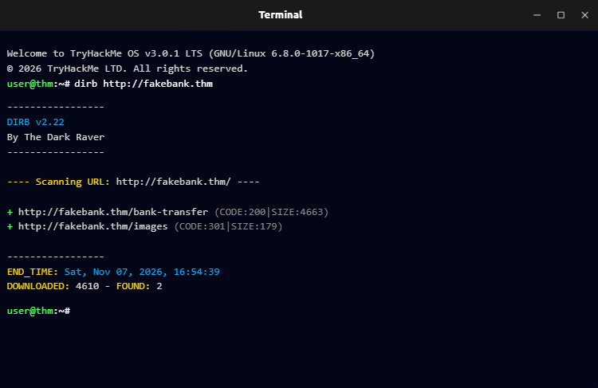
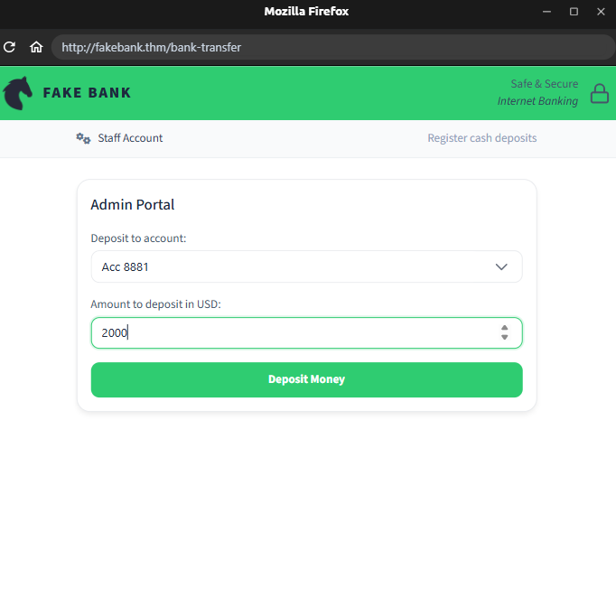
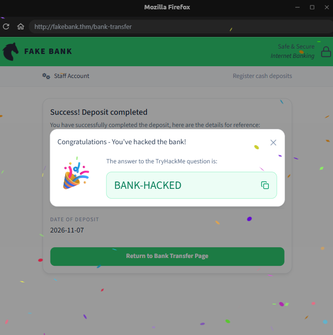

# Introdução à Segurança Cibernética

Este é o primeiro módulo da trilha Pre Security do TryHackMe. Nele, tive meu primeiro contato com a área de cibersegurança, conhecendo conceitos de segurança ofensiva, segurança defensiva e algumas das possibilidades de carreira.

## Salas do módulo

### 1. Introdução à Segurança Ofensiva

[Acessar sala no TryHackMe](https://tryhackme.com/room/offensivesecurityintro)

Nesta atividade, utilizei o FakeBank, um site bancário fictício disponibilizado pelo TryHackMe, para entender como funciona uma prática de segurança ofensiva em um ambiente controlado.

**O que aprendi na prática:**

- Como utilizar o terminal Linux.
- Como executar a ferramenta Dirb.
- Como procurar diretórios e páginas em um site.
- Como identificar um painel administrativo.
- Como explorar uma vulnerabilidade em um ambiente de testes.

**Atividade realizada:**

Executei o comando `dirb http://fakebank.thm` para localizar diretórios e páginas disponíveis no site. Com os resultados, encontrei o painel administrativo e realizei a operação solicitada pelo desafio.

**Ferramenta utilizada:**

- Dirb.

**Prints da atividade:**

As evidências da atividade prática estão disponíveis abaixo:

### 2. Introdução à Segurança Defensiva

[Acessar sala no TryHackMe](https://tryhackme.com/room/def
